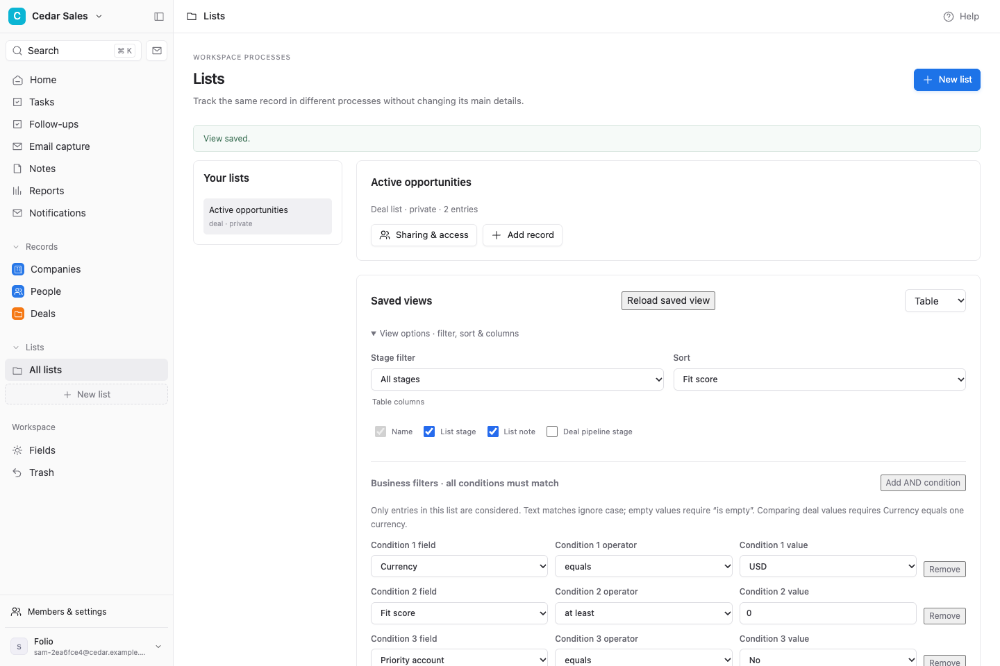

# Folio

A workspace CRM for companies, contacts, deals and the work around them.

**Product inspiration:** Attio-inspired relationship management, with its own Folio branding.

**Neander library:** Folio · **Category:** Sales & CRM



## What you can build

- Manage companies, people and a deal pipeline with stage history and currency-aware values.
- Keep notes, assign tasks and view activity on records.
- Let Admin-managed stage-change rules create assigned follow-up tasks atomically, with explicit timezone deadlines and execution history.
- Organize records into private/shared lists and saved table or board views. Deal lists support typed AND filters, business/custom columns and stable sorting, with currency and archived-field safeguards.
- Add custom fields, import/export CSV and review reports.
- Control workspace access with Admin, Member and Viewer roles.

## How this fits into Neander

This is the open-source app behind Neander’s **Folio** starter. You can
run and modify it on its own without a Neander account, or use it as a starting
point in Neander.

1. Choose **Use Template** in [Neander](https://neander.ai).
2. Neander creates a normal project from a registered version of this repository,
   with fresh Git history, and publishes a working app with sample data.
3. Open the live app and continue in the project. Prompt Neander to make changes
   in the codebase, just as you would in any other project.
4. Use **Publish** again when you want your changes reflected in the live app.

Your project starts from one version. Later changes to this repository or the
template library do not overwrite your project. Linked IDE projects use their
checkout; web projects use Neander’s managed project source.

## Run locally

Stack: Next.js, React, TypeScript, PostgreSQL and Drizzle; database-backed email/password sessions.

Use **Node 24.22.3** and **pnpm 11.18.0**. Versions are listed in
`mise.toml`; if you use mise, run `mise install`. Install Docker for the local
PostgreSQL service. Python 3.12 with PyYAML is needed for this repository’s Python checks.

### 1. Install the app

```sh
git clone https://github.com/neanderhq/folio.git
cd folio
pnpm install --frozen-lockfile
cp .env.example .env.local
```

### 2. Start local PostgreSQL

```sh
PGPORT=55433 docker compose -p folio-dev -f compose.dev.yaml up -d --wait
```

The example database URL uses port `55433`. The Compose project name keeps
this app’s development data separate from other checkouts.

### 3. Configure the app

Edit `.env.local`. The database URL is already set for the local service above.

| Variable | Purpose |
| --- | --- |
| `DATABASE_URL` | PostgreSQL connection used by this local app. |

These database credentials are for the loopback development service. Neander
supplies a managed database connection and generated runtime secrets when it
publishes a project. Keep your local environment file out of Git.

### 4. Initialize and start

```sh
node --env-file=.env.local .neander/migrate.mjs
node --env-file=.env.local scripts/initialize-template.mjs
pnpm dev
```

Open **http://127.0.0.1:3000**.

Create an account and workspace using the app. Template initialization enables
fictional CRM data for new workspaces; it creates no shared account or password.
Existing workspaces can be explicitly seeded with `DEMO_WORKSPACE_ID=<uuid> pnpm seed`.

### Try the CRM flow

Create an account and workspace, open **Companies** or **Deals**, and edit a fictional record. Add a note or task, then check the board and reports.

## Sample data

Fictional companies, contacts, deals, notes and tasks in each new private workspace after template initialization.

All sample people, organizations and responses are fictional. Seed retries preserve
existing changes and credentials. Normal app restarts do not reset your data.

## Development and checks

```sh
python3.12 -m venv .venv
. .venv/bin/activate
python -m pip install PyYAML==6.0.3
pnpm check
pnpm test
pnpm build
```

Public CI runs these app checks and a production build without Neander’s private
publishing tools or cloud credentials. Full template image/database verification
and library publication are run manually by Neander maintainers in private CI.
Merging a contribution does not automatically update the template library.

## Repository layout

| Path | Purpose |
| --- | --- |
| `app/` | CRM UI and API routes. |
| `server/` | Authentication, workspace permissions, record operations and sample data. |
| `shared/` | Shared app types. |
| `drizzle/` | Versioned PostgreSQL migrations. |
| `.neander/template.yaml` | Library metadata and install/check/test/seed commands. |
| `.neander/compose.yaml` | Normal Neander Publish recipe and runtime requirements. |
| `scripts/initialize-template.mjs` / `server/demo-seed.ts` | Enable sample initialization and seed new workspaces. |
| `scripts/verify-template.ts` | Maintainer verification of the built app image. |

## Maintaining the Neander template

The `.neander/template.yaml` manifest defines the library entry and verification
commands. `.neander/compose.yaml` defines the app’s normal Publish recipe,
including PostgreSQL, migrations and generated secrets. Keep these files in sync
when changing database, authentication or runtime requirements.

Neander’s private release workflow checks out an exact GitHub commit, verifies
the built app with a disposable database, and registers its image and metadata.
The application source stays in this repository.

## Contributing

Fork the repository, make a focused change, and run the checks above before
opening a pull request. Include the behavior you changed and how you verified it.
A maintainer decides when to publish a new version to Neander’s library.

## License

[MIT](LICENSE). Third-party components retain their respective licenses and
existing attribution notices.

## Security

See [SECURITY.md](SECURITY.md) for private vulnerability reporting and the automated security checks.

## Contributing and checks

Use the pinned tools in `mise.toml`. Run `pnpm verify` for source validation;
see [development setup](docs/development.md) and [verification coverage](docs/testing.md)
for production-image tests and CI. Work through a feature branch and PR; preserve
the existing application, deployment recipe, fictional seeds and MIT license.
